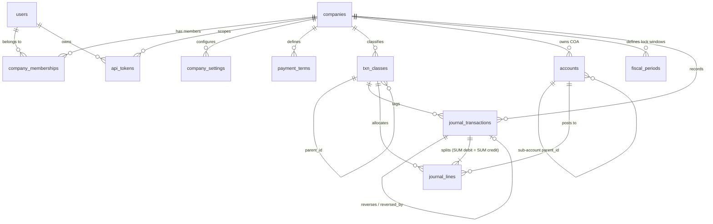
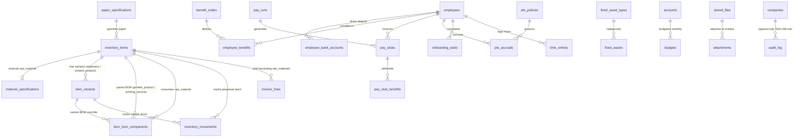
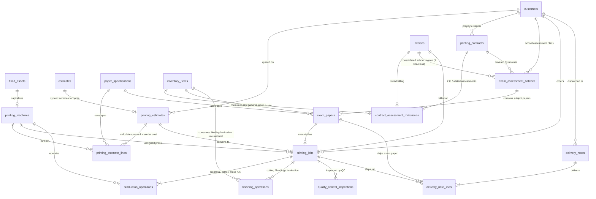

# Target Entity-Relationship Diagram (ERD) — Printing Management System

This document defines the complete target PostgreSQL 17 entity-relationship architecture reconstructed from `SlowBooks-Pro-2026` and extended for commercial & educational printing operations. Every tenant-scoped entity includes `company_id` paired with composite `UNIQUE (company_id, id)` parent keys and Row-Level Security (`FORCE ROW LEVEL SECURITY`).

---

## Domain 1: Identity, Company Isolation & Core Accounting (Migrations `0001`–`0002`)

---

## Domain 2: Customers, Sales, Receivables, Suppliers, Purchases & Banking (Migrations `0003`–`0004`)

```mermaid
erDiagram
    companies ||--o{ customers : "serves"
    customers ||--o{ customers : "sub-customer parent"
    payment_terms ||--o{ customers : "defaults"
    customers ||--o{ reseller_permits : "holds exemption"
    customers ||--o{ estimates : "receives quote"
    estimates ||--|{ estimate_lines : "contains"
    estimates ||--o{ invoices : "converts to"

    customers ||--o{ invoices : "billed on"
    journal_transactions ||--o| invoices : "posts AR & Revenue"
    invoices ||--|{ invoice_lines : "itemizes"
    invoices ||--o{ invoice_reminders : "triggers"
    invoice_reminder_rules ||--o{ invoice_reminders : "governs"

    customers ||--o{ payments : "remits"
    accounts ||--o{ payments : "deposits to"
    payments ||--|{ payment_allocations : "settles"
    invoices ||--o{ payment_allocations : "paid by"

    customers ||--o{ credit_memos : "issued"
    credit_memos ||--|{ credit_memo_lines : "details"
    credit_memos ||--o{ credit_applications : "applied via"
    invoices ||--o{ credit_applications : "credited by"

    customers ||--o{ recurring_invoices : "schedules"
    recurring_invoices ||--|{ recurring_invoice_lines : "templates"

    companies ||--o{ vendors : "buys from"
    accounts ||--o{ vendors : "default expense"
    vendors ||--o{ purchase_orders : "receives PO"
    purchase_orders ||--|{ purchase_order_lines : "orders"
    vendors ||--o{ bills : "issues bill"
    bills ||--|{ bill_lines : "expensed on"
    vendors ||--o{ bill_payments : "paid via"
    bill_payments ||--|{ bill_payment_allocations : "settles"
    bills ||--o{ bill_payment_allocations : "paid by"
    vendors ||--o{ vendor_credits : "grants"
    vendor_credits ||--|{ vendor_credit_lines : "details"
    vendor_credits ||--o{ vendor_credit_applications : "offsets"
    bills ||--o{ vendor_credit_applications : "reduced by"

    accounts ||--|| bank_accounts : "linked GL"
    bank_accounts ||--o{ reconciliations : "reconciled by"
    bank_accounts ||--o{ bank_transactions : "holds feed/register"
    reconciliations ||--o{ bank_transactions : "clears"
    bank_transactions ||--o| bank_check_details : "check stub"
    bank_transactions ||--o{ deposit_other_lines : "multi-source deposit"
    bank_transactions ||--o{ duplicate_dismissals : "dismissed dup"
```

---

## Domain 3: Paper Specs, Materials, 4-Type Inventory, Variants, BOMs & Payroll/Assets/Audit (Migrations `0005`–`0006`)

---

## Domain 4: Printing Estimates, Machines, Production, Finishing, QC, Delivery, Exams & Contracts (Migration `0007`)

